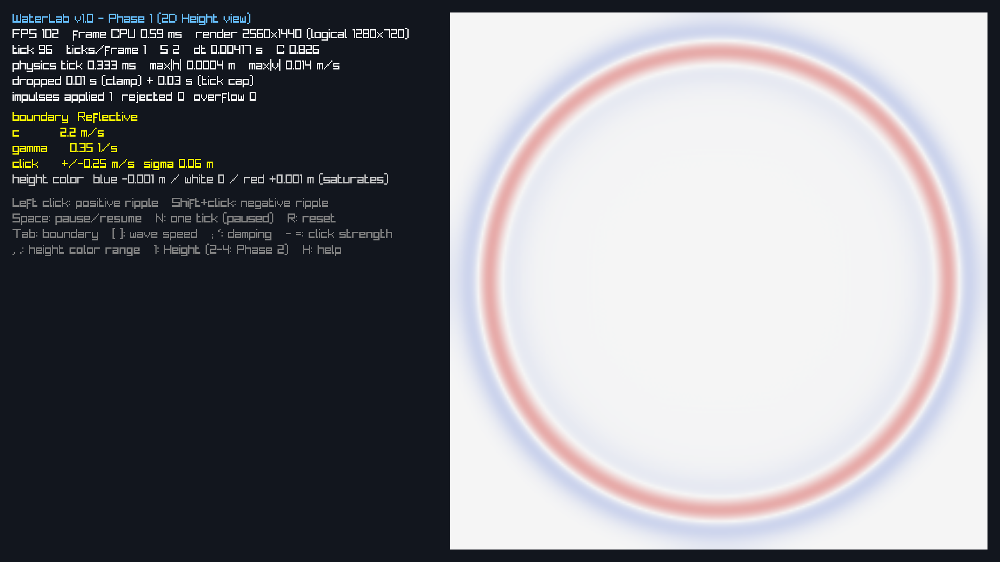

# 水面シミュレーションと描画の解説（WaterLab で使っている考え方）

**最終更新**: 2026-10-28（Phase 1 まで）

開発中に出た疑問を、「WaterLab で、実際に何が起きているか」に結びつけて説明します。
要件は [仕様書](spec/realtime_water_ripple_spec_v1.0_ja.md)、判断の理由は [decisions.md](decisions.md)、検証結果は [validation.md](validation.md)、作業の記録は [WORKLOG.md](WORKLOG.md) にあります。ここは「なぜそうするのか」を、コードを読まなくても分かる程度に書く場所です。

数値は、実際に測ったもの（出典を書いたもの）だけを載せています。

## 目次

1. [1 tick で何が起きるか](#1-1-tick-で何が起きるか)
2. [高さ場と波動方程式](#2-高さ場と波動方程式)
3. [格子: 256 標本と 255 セル](#3-格子-256-標本と-255-セル)
4. [ラプラシアン: 隣との差で「曲がり具合」を測る](#4-ラプラシアン-隣との差で曲がり具合を測る)
5. [時間積分: velocity Verlet と減衰](#5-時間積分-velocity-verlet-と減衰)
6. [CFL 条件とサブステップ](#6-cfl-条件とサブステップ)
7. [固定 tick と描画補間](#7-固定-tick-と描画補間)
8. [境界条件: Fixed・Reflective・Absorbing](#8-境界条件-fixedreflectiveabsorbing)
9. [クリック波紋: 速度インパルスとゼロ平均カーネル](#9-クリック波紋-速度インパルスとゼロ平均カーネル)
10. [エネルギーで計算の正しさを確かめる](#10-エネルギーで計算の正しさを確かめる)
11. [異常停止: 発散を隠さない](#11-異常停止-発散を隠さない)
12. [Height 表示と色の範囲](#12-height-表示と色の範囲)
13. [用語集](#13-用語集)

---

## 1. 1 tick で何が起きるか

物理は 1 秒に 120 回（1 tick = 1/120 s）、描画とは独立に進みます。1 tick の中身:

1. tick の境界で、たまっていた設定変更（波速 c、減衰 γ、境界）を適用する。
2. クリックで積まれた入力（インパルス）を、**1 回だけ**水面の速度へ加える。
3. 波の計算を S 回（サブステップ、既定 2 回）進める。
4. 異常（発散・NaN）がないか調べる。
5. 結果の高さを、描画用のスナップショットにコピーする。

描画は、直前 2 回の tick の高さを混ぜて（補間して）表示します（7章）。

## 2. 高さ場と波動方程式

水を本当に解く（3次元の流れを計算する）のは重いので、WaterLab は水面の**高さだけ**を持ちます。各点の静水面からのずれ h と、その上下の速さ v = dh/dt です。

```text
dh/dt = v
dv/dt = c² ∇²h − γ v + a_external
```

| 項 | 意味 |
|---|---|
| c² ∇²h | 周りより低い点は持ち上げられ、高い点は押し下げられる（復元力）。c は波の速さ |
| −γ v | 動きにブレーキをかける（減衰）。高さそのものを毎フレーム縮めるのではない |
| a_external | 外から加える加速度（Phase 4 の球体で使う） |

この式で表せるのは「同じ速さ c で伝わる小さな波」だけです。水平方向の流れ、渦、しぶき、砕ける波は表せません。本物の水の波は波長によって速さが違いますが（分散）、ここでは c を実験用の定数として扱います。

## 3. 格子: 256 標本と 255 セル

4 m × 4 m の水面を、縦横 256 個ずつの点（**標本**）で表します。端の点も含めて 256 個なので、点と点の間（**セル**）は 255 個です。

```text
dx = 4 m / 255 ≈ 0.01569 m（約 1.6 cm）
x(i) = −2 + i·dx    （i = 0 … 255）
```

「256 セル」と取り違えると、間隔が 4/256 になって、位置も CFL の計算もずれます。

### 台形則の面積

合計や平均を取るとき、各点が受け持つ面積を**台形則**で決めます。内部の点は dx·dz、辺の点はその半分、角の点は 1/4 です。全点の合計がちょうど 16 m² になります（テスト `GridGeometryMatchesSpec`）。

この面積は、クリック入力のゼロ平均（9章）、エネルギー（10章）、Phase 4 の反作用の分配など、**和を取る場所すべてで同じものを使います**。場所ごとに違う重みを使うと、「合計がゼロ」「エネルギーが保存する」といった性質が崩れます。

## 4. ラプラシアン: 隣との差で「曲がり具合」を測る

∇²h（ラプラシアン）は、その点が周りと比べてどれだけ凹んでいるか（または盛り上がっているか）です。格子では、上下左右の 4 つの隣を使って計算します。

```text
L(h)[i,j] = (h[i+1,j] − 2h[i,j] + h[i−1,j]) / dx²
          + (h[i,j+1] − 2h[i,j] + h[i,j−1]) / dz²
```

- 平らな面（全点が同じ高さ）では 0。
- 周りより低い点では正（持ち上げる向き）。

**注意**: h を左上から順に書き換えながら計算すると、ある点では「もう更新された隣」と「まだ古い隣」が混ざってしまいます。WaterLab は、ラプラシアンを別の配列に全部計算してから h を更新します。

## 5. 時間積分: velocity Verlet と減衰

時間を少しずつ（dt ずつ）進める方法として、**velocity Verlet** を使います。1 サブステップの手順:

```text
v ← v × exp(−γ dt/2)          減衰を半分
v ← v + (dt/2) × a(h)          加速度で半分だけ速度を変える（前半 kick）
h ← h + dt × v                 その速度で位置を進める（drift）
（境界の処理）
v ← v + (dt/2) × a(新しい h)   新しい位置の加速度で、残り半分（後半 kick）
v ← v × exp(−γ dt/2)          減衰の残り半分
```

単純な方法（Euler 法: 今の加速度で速度と位置を一気に進める）より、ほんの少し手間が増えるだけで、ずっと正確で安定です。特に、**エネルギーが長時間ずれていかない**性質があります（10章）。

減衰を前後半分ずつに分けるのは、手順を前後対称にして、精度（2次）を保つためです。

### 計算を1回分減らす工夫

後半 kick で計算した L(新しい h) は、次のサブステップの前半 kick で必要な L(h) と同じものです（h がその間に変わっていなければ）。そこで保存して使い回し、ラプラシアンの計算を 1 サブステップあたり 2 回から 1 回にしています。毎回計算し直した場合と結果が**ビット単位で一致する**ことをテストで確かめています（`LaplacianCacheMatchesRecompute`）。

## 6. CFL 条件とサブステップ

1 回に進める時間 dt が長すぎると、波が 1 回の計算で隣のさらに先まで進むことになり、計算が爆発します。安全な dt の上限を決めるのが **CFL 条件**です。

```text
C = c × dt × √(1/dx² + 1/dz²)  ≤ 0.90
```

1 tick（1/120 s）がこの上限を超える場合は、tick を S 回に分けて計算します（サブステップ）。dt を勝手に大きくして合わせることはしません。

| 条件 | S | dt | C |
|---|---:|---:|---:|
| 既定（256²、c = 2.2 m/s） | 2 | 1/240 s | 0.826 |
| 512²、c = 2.2 m/s | 4 | 1/480 s | — |
| 256²、c = 5.0 m/s | 5 | 1/600 s | ≦ 0.90 |

（出典: テスト `T02_CflSubstepPlanning`、`SettingsAppliedAtTickBoundary`）

格子を細かくする（dx が半分）、または波を速くすると、必要な S が増えます。S が上限（16）を超える設定は、理由を表示して受け付けません。

CFL 条件が保証するのは、**波の計算そのもの**の安定性だけです。Phase 4 の球体との結合は、別に検証します。

## 7. 固定 tick と描画補間

画面の更新回数（FPS）は、機械の負荷や VSync で変わります。物理の dt を FPS に合わせると、同じ操作でも結果が変わってしまいます。WaterLab は、経過した実時間を貯金（accumulator）し、1/120 s たまるごとに 1 tick 進めます（Fix Your Timestep 方式）。

- **30 / 60 / 144 FPS で動かしても、同じ tick 番号の水面は完全に一致します**（テスト `T08_FrameRateIndependence`、h と v の全要素がビット一致）。
- 描画の瞬間は tick と tick の間にあることが多いので、直前の 2 tick の高さを、貯金の残り（alpha）の割合で混ぜて表示します。物理の計算には、この補間した値を使いません。

### 遅れたときの安全装置

ウィンドウを動かしたなどで 1 フレームが長くかかると、追いつくために大量の tick を一度に計算しようとして、さらに遅くなる悪循環が起きます。そこで:

- 1 フレームで受け付ける実時間は 0.1 s まで。
- 1 フレームで計算する tick は 8 回まで。

超えた分の時間は捨て、画面に「dropped」として累計を表示します。シミュレーションは実時間より遅れますが、操作不能にはなりません。

## 8. 境界条件: Fixed・Reflective・Absorbing

水面の端（4 m の正方形の縁）で何が起きるかを、3 種類から選べます（Tab キー）。

| モード | 端の扱い | 反射した波 |
|---|---|---|
| Fixed | 端の点の高さを常に 0 に固定する | **上下が反転**して戻る（山が谷になる） |
| Reflective | 端の外側に、内側の鏡写しの点があると考える（h[−1] = h[1]） | **同じ向き**で戻る（山は山のまま） |
| Absorbing | Reflective に加え、端から 0.5 m の帯で減衰を強める | 弱まって戻る（完全には消えない） |

反射の向きの違いは、細長い水路に山形のパルスを置いて確かめています。Fixed では戻ってきた波が負、Reflective では正になります（テスト `ReflectionSignDependsOnBoundary`）。

身近な例では、Fixed は「端を手で押さえた縄」、Reflective は「端が自由に上下できる縄」に似ています。プールの壁で反射する水の波は Reflective に近い振る舞いです。

### 吸収帯

端までの距離 d が帯の幅 W（0.5 m）より小さい場所で、減衰を足します。

```text
s = (W − d) / W      （0〜1。端で 1）
γ = γ0 + 8.0 × s²
```

d は「一番近い端までの距離」なので、角でも 2 辺分が二重に足されることはありません（テスト `SpongeDampingField`）。急に減衰を強めると、その境目自体で波が反射するので、s² でなめらかに強めています。

Absorbing でどれだけ反射が減るかの定量評価（仕様書 §12.3: 中心のエネルギーが Reflective の 50% 以下）は Phase 3 で行います（未実施）。

## 9. クリック波紋: 速度インパルスとゼロ平均カーネル

クリックすると、その位置の周りの**速度 v**を一度だけ変えます。高さ h を直接変えるのではありません。水面を指で弾いたときのように、その場所が動き始め、そこから波が広がります。

- 入力は「ピーク速度変化」（既定 0.25 m/s）です。力ではないので dt を掛けません。
- サブステップが 2 回でも 5 回でも、加えるのは 1 回だけです（テスト `T04_WorldAppliesImpulseOnce`）。

### なぜゼロ平均にするか

単純なガウス分布（山形）で速度を加えると、水面全体が少し持ち上がる方向に動き出し、平均水位がずれていきます（既定のクリック 1 回で、面積 × 速度の合計が 5.6×10⁻³ m³/s。出典: 下記の測定）。

そこで既定では、2 つのガウス分布の差をとります。

```text
g1 = 幅 σ のガウス（3σ で打ち切り）
g2 = 幅 2σ のガウス（6σ で打ち切り）
K = (g1 − b × g2) / 最大値、 b は Σ A·g1 = b × Σ A·g2 となるように選ぶ
```

中心は上向き、その周り（半径約 0.18 m）は弱い下向きになり、全体の合計がちょうど 0 になります。

| 測定値（256²、σ = 0.06 m、中心のクリック） | 値 |
|---|---|
| 中心の速度変化 | +0.2500 m/s |
| 最も負の速度変化 | −0.0261 m/s（中心から 0.183 m） |
| Σ A·K ÷ Σ A·\|K\|（ゼロ平均の度合い） | −3.4×10⁻⁹ |

（出典: 2026-10-28 の測定プログラム。仕様書の判定基準は 1×10⁻⁵ 以下で、テスト `T05_ZeroMeanKernel` が端・角・Fixed でも確認）

端に近くて分布が欠ける場合も、b を「領域内に残った部分」で計算し直すので、合計は 0 のままです。

## 10. エネルギーで計算の正しさを確かめる

摩擦（減衰）がなければ、波のエネルギー（動きのエネルギー＋高さのエネルギー）は変わらないはずです。計算でこれが保たれるかを見ると、時間積分が正しいかが分かります。

```text
E = ½ Σ A·v²  −  ½ c² Σ A·h·L(h)
```

第 2 項は「面がどれだけ曲がっているか」のエネルギーです（L(h) は負になりやすいので、マイナスを付けると正）。

| 条件（Fixed、最も低い固有モード、振幅 0.01 m、減衰なし、30 s） | E の変動幅 ÷ 初期値 |
|---|---:|
| S = 2（dt = 1/240 s） | 2.66×10⁻⁵ |
| S = 4（dt = 1/480 s） | 7.07×10⁻⁶ |

dt を半分にすると誤差が約 1/3.8 になりました。2 次の精度の方法では 1/4 になるはずなので、ほぼ理論どおりです。（出典: 2026-10-28 の測定プログラム。仕様書の判定基準は 1% 以下）

Verlet でも、E は毎ステップ厳密に一定ではなく、小さく揺れます。それでも「ずれが溜まっていかない」のが Verlet の利点です。

減衰あり（γ = 0.35 s⁻¹）では、1 秒ごとの平均エネルギーが毎秒減り続け、30 s 後に初期の 10% 未満になることを確かめています（テスト `EnergyDecaysWithDamping`）。

## 11. 異常停止: 発散を隠さない

次のどれかが起きたら、物理を止めて理由（原因、tick、設定）を表示します。R キーでリセットすると再開します。

- 高さ |h| が 0.5 m を超えた
- 速度 |v| が 10 m/s を超えた
- NaN（非数）や Inf（無限大）が出た

値を毎回クランプして「安定しているように見せる」ことはしません。発散は、CFL 違反や結合の強すぎなど、どこかに原因があるサインなので、隠すと原因を探せなくなります。

## 12. Height 表示と色の範囲

Phase 1 では、水面を真上から見た 2D の画像で表示します。高さを色に写します。

- 青: 静水面より低い　／　白: 静水面　／　赤: 静水面より高い
- 範囲を超えた値は、いちばん濃い色のまま（飽和）。

### 「画面が真っ白」だった理由

最初の版は、仕様書どおり ±0.05 m で色を付けていました。ところが、既定のクリックで生まれる波は、とても小さいのです。

| 時刻（クリック後） | 最大の高さ \|h\| | その位置（中心からの距離） |
|---|---:|---:|
| 0.05 s | 3.1 mm | 0.01 m |
| 0.1 s | 1.3 mm | 0.18 m |
| 0.4 s | 0.56 mm | 0.84 m |
| 0.8 s | 0.36 mm | 1.72 m |

（出典: 2026-10-28 の測定プログラム、256²、既定設定）

0.4 mm は ±0.05 m の 1% 未満なので、ほぼ白にしか見えませんでした。いまは既定の範囲を ±0.001 m にし、`,` `.` キーで ±0.0005〜0.05 m を切り替えられます（[decisions.md](decisions.md) D09）。

表の「位置」を見ると、0.4 s で 0.84 m、0.8 s で 1.72 m と、ほぼ c × t（0.88 m、1.76 m）の距離に波の山があります。波が設定どおりの速さで広がっていることが、ここからも分かります。



山（赤）が広がって大きくなるにつれて低くなるのは、同じエネルギーが長い円周に広がるからです（2次元の波では、振幅はおよそ 1/√距離 で小さくなります）。

## 13. 用語集

| 用語 | 意味 |
|---|---|
| 高さ場（height field） | 水面を「各点の高さ」だけで表す方法。波が重なったり崩れたりする形は表せない |
| 標本（sample） | 格子の点。256×256 個 |
| セル（cell） | 隣り合う標本の間の四角。255×255 個 |
| tick | 物理の 1 回分の更新。1/120 s |
| サブステップ（substep） | 1 tick を CFL 条件のために分割したもの。既定は 2 回 |
| CFL 条件 | 1 回の計算で波が進む距離を、格子の間隔より十分小さく保つ条件 |
| velocity Verlet | 速度を半分ずつ 2 回に分けて更新する時間積分法。エネルギーが長時間ずれにくい |
| ラプラシアン（∇²） | 周りの点との差の合計。面の曲がり具合 |
| インパルス | 一瞬で速度を変える入力。力（時間をかけて加速）とは別物 |
| 台形則 | 端の点の受け持ち面積を半分（角は 1/4）にする積分の方法 |
| ノイマン条件 | 端で面の傾きを 0 にする境界条件（Reflective） |
| ディリクレ条件 | 端で値そのものを固定する境界条件（Fixed） |
| スポンジ（吸収帯） | 端の近くだけ減衰を強めて、反射を弱める帯 |
| accumulator | 経過した実時間の貯金。tick 1 回分たまるごとに 1 tick 進める |
